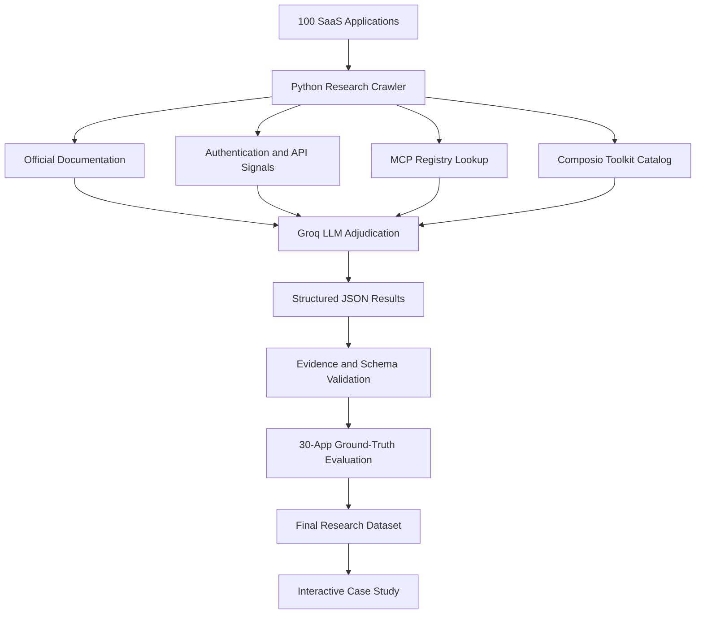

# Mapping the Agent-Ready App Ecosystem

### Evaluating 100 SaaS applications for AI integration readiness

An AI-assisted research pipeline built for the **Composio AI Product Ops take-home assignment**. This project investigates how accessible SaaS applications are for developers and AI agents by examining their authentication methods, API availability, credential access, MCP support, and integration feasibility.

<p align="center">
  
  
  
  
</p>

<p align="center">
  <a href="YOUR_VERCEL_URL">View Interactive Case Study</a>
  &nbsp; · &nbsp;
  <a href="#research-results">Explore Research Results</a>
</p>

---

## Overview

As AI agents become increasingly capable of interacting with external software, understanding which applications are actually integration-ready becomes important.

A product may advertise API support, but developers still need to understand:

- What authentication methods are supported?
- Can developers obtain API credentials independently?
- Is API access self-serve or restricted behind sales or partnerships?
- Does the product provide an official MCP server?
- What prevents an integration from being built?

This project explores these questions across **100 applications spanning 10 software categories**.

## Research at a Glance

| Metric | Result |
|---|---:|
| Applications researched | 100 |
| Software categories | 10 |
| Valid research records | 100 |
| Independently sampled applications | 30 |
| Scorable ground-truth claims | 144 |
| Groq exact-match accuracy | 62.5% |
| Groq partial-match accuracy | 78.5% |
| Unresolved applications after retries | 0 |

## What Was Evaluated?

Each application was evaluated across five dimensions:

| Dimension | Research question |
|---|---|
| Authentication | OAuth, API keys, tokens, Basic Auth, or other methods? |
| API availability | What API surface does the vendor expose? |
| Credential access | Can developers self-serve credentials, or is access gated? |
| MCP availability | Does an official or third-party MCP implementation exist? |
| Integration feasibility | Is the application ready to integrate, and what are its blockers? |

## Research Categories

The dataset covers 10 categories:

1. CRM
2. Customer Support
3. Communications
4. Marketing
5. E-commerce
6. Data and SEO
7. Developer Infrastructure
8. Productivity
9. Fintech
10. AI and Media

## System Architecture

The project combines deterministic data collection, LLM-based reasoning, integration-tool discovery, and independent validation.



### Technology Stack

| Technology | Purpose |
|---|---|
| Python 3.11 | Research orchestration and data processing |
| Groq SDK | LLM-based evidence interpretation and structured output |
| OpenAI GPT-OSS models via Groq | Research adjudication |
| Composio SDK | Toolkit discovery and tool-execution demonstration |
| Official MCP Registry API | MCP availability lookup |
| HTML, CSS, JavaScript | Interactive research dashboard |

## Research Results

### Accuracy Comparison

The research pipeline was evaluated against a 30-application ground-truth sample containing 144 scorable claims.

| Research stage | Exact accuracy | Partial accuracy |
|---|---:|---:|
| Pass 1 — Homepage crawler | 29.9% | 37.5% |
| Pass 2 — Deep documentation crawler | 45.8% | 61.1% |
| Groq LLM adjudication | **62.5%** | **78.5%** |

Groq's exact accuracy improved over both crawler baselines on the sampled claims.

### Groq Performance by Field

| Research dimension | Exact matches |
|---|---:|
| Authentication | 17/29 |
| API type | 27/30 |
| Credential access | 12/27 |
| MCP availability | 15/30 |
| Buildability verdict | 19/28 |

**Important finding:** MCP classification was weaker with Groq than with the deep crawler, which achieved 23/30. Groq sometimes misclassified official vendor MCP servers as community implementations or marked them unclear.

### Model Comparison

| Model | Sample applications | Exact accuracy |
|---|---:|---:|
| GPT-OSS 120B | 18 | 55.2% |
| GPT-OSS 20B | 12 | 73.7% |

This is not a controlled comparison. The fallback model processed different applications after the primary model reached its daily token limit. The difference should not be interpreted as evidence that the smaller model is more accurate.

## Validation and Reliability

The pipeline incorporates several reliability mechanisms:

- Evidence URLs are checked against pages actually fetched.
- Structured outputs must pass exact schema validation.
- Positive claims require supporting evidence.
- Failed generations are preserved in an append-only attempt log.
- Applications with failed generations are retried.
- Successful records are checkpointed and preserved.
- Human-review corrections are kept separate from original model predictions.

### Final Run Statistics

| Metric | Result |
|---|---:|
| Valid records | 100/100 |
| Failed applications recovered through retries | 8 |
| Rejected attempts | 9 |
| Unresolved applications | 0 |
| Successful Groq API calls | 211 |
| Recorded input tokens | 364,028 |
| Recorded output tokens | 69,364 |
| Total recorded tokens | 433,392 |

Failed requests may have additional token consumption not included in the recorded totals.

## Composio Integration Demonstration

Composio was integrated using its official Python SDK.

The separate integration test demonstrated:

- SDK initialization.
- Toolkit discovery.
- Tool-schema retrieval.
- Session creation.
- Read-only schema execution.
- A live Groq-to-Composio tool-calling round trip.

**Important distinction:** Composio's tool-calling path was demonstrated separately. During the actual 100-application research run, Groq made 46 tool calls, all of which reread previously fetched pages. It did not select Composio tools during that run.

No external GitHub account was connected or modified.

## Verification Methodology

A seeded sample of 30 applications, three from each category, was selected before the Groq adjudication run.

The ground truth was prepared with LLM assistance using fetched official documentation and vendor MCP sources, without consulting Groq's answers.

- 144 claims were scored.
- Six unsettled claims were excluded.
- 54 sampled field values were subsequently corrected in the final dataset.
- Accuracy figures above use Groq's original, uncorrected predictions.

**Verification limitation:** The ground-truth sample has not yet been independently re-checked by a person. The remaining 70 applications have not received independent ground-truth review.

## Limitations

This research has several limitations:

1. Only 30 of the 100 applications received ground-truth evaluation.
2. The ground-truth sample was prepared with LLM assistance and has not been independently rechecked by a person.
3. MCP classification remains a weak area for Groq.
4. Model comparison is confounded by different application samples.
5. Credential-access information can be difficult to establish from public documentation.
6. Composio integration was demonstrated separately rather than used for all 100 investigations.
7. Vendor documentation and API availability can change over time.

These limitations are retained in the case study rather than hidden behind the headline accuracy figures.

## Repository Structure

```text
composio-ecosystem-research/
│
├── agent/                  # Research and adjudication pipeline
├── data/                   # Application datasets and research outputs
├── dashboard/              # Research dashboard
├── ui-prototype/           # Interactive case-study interface
├── logs/                   # Execution and integration evidence
├── tests/                  # Integration tests
├── verification/           # Ground truth and accuracy evaluation
│
├── README.md
├── requirements.txt
└── .env.example
```

## Getting Started

### Prerequisites

- Python 3.11+
- Groq API key
- Composio API key

### Installation

```bash
git clone https://github.com/JenzUwU/Composio-ecosystem-research-agent.git
cd Composio-ecosystem-research-agent

python -m venv .venv
```

Windows:

```powershell
.venv\Scripts\activate
pip install -r requirements.txt
```

Create a `.env` file using `.env.example` and configure your API keys:

```env
GROQ_API_KEY=your_groq_api_key
COMPOSIO_API_KEY=your_composio_api_key
```

Never commit your `.env` file.

### Run the Dashboard

```bash
python -m http.server -d dashboard 8000
```

Open:

`http://localhost:8000`

For the complete research pipeline, reproducibility instructions, retry workflow, and validation commands, see the detailed instructions in the repository.

---

## Project Context

**Built as part of the Composio AI Product Ops Intern take-home assignment.**

The objective was to investigate the agent-ready software ecosystem, build an evidence-backed research workflow, and evaluate how effectively an LLM can interpret developer-facing integration documentation.

**Research date:** 24 November 2026.

<p align="center">
  <b>Built with Python · Groq · Composio</b>
</p>
